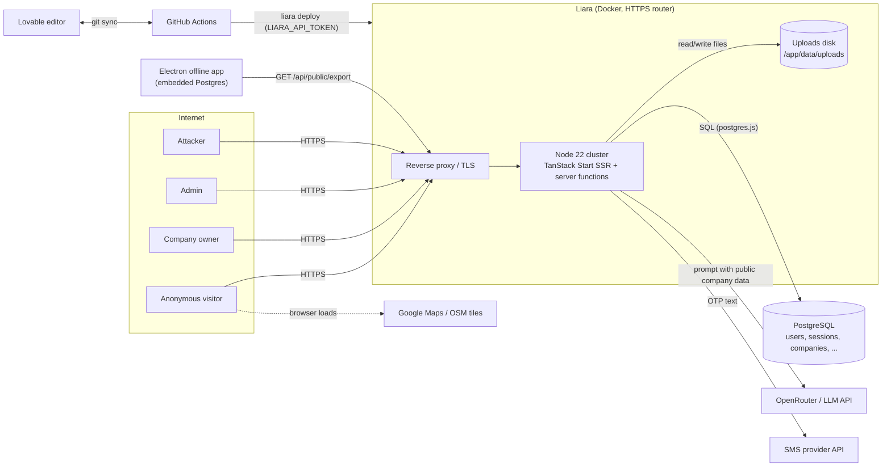

# Architecture Map

Derived from the code (entry points, imports, migrations, Dockerfile, workflows), not
from documentation alone.

## Components

| Component | Technology | Evidence |
|---|---|---|
| Web app (SSR + client) | React 19.2, TanStack Start 1.169 / Router 1.170, Vite 8, Nitro `node-server` preset | `package.json`, `vite.config.ts`, `src/router.tsx` |
| Server API | TanStack Start **server functions** (67 in 11 `src/lib/*.functions.ts` modules) + 5 HTTP routes under `/api/public/*` + `/assets/*` | `src/lib/*.functions.ts`, `src/routes/api/public/`, `src/routes/assets.$.ts` |
| Request pipeline | Custom fetch wrapper adds request id, CSP and security headers, catches SSR errors | `src/server.ts`, `src/start.ts` |
| Process model | Node 22 cluster (`WEB_CONCURRENCY` workers) | `server/cluster.mjs`, `Dockerfile` |
| Database | Self-hosted PostgreSQL via `postgres` (postgres.js) tagged templates; migrations applied automatically at startup (`AUTO_MIGRATE`, default on) | `db/connection.ts`, `src/lib/db/auto-migrate.server.ts`, `db/migrations/0001…0022` |
| Auth | Own implementation: scrypt passwords, opaque session tokens in `sessions` table + `httpOnly` cookie, roles in `user_roles` (`admin`, `user`, `company_owner`), optional SMS OTP step-up (`MFA_ENFORCED`) | `src/lib/auth/*`, `src/lib/auth.functions.ts`, `src/lib/mfa*` |
| File storage | Local disk under `UPLOAD_DIR` (Liara mounted disk `/app/data/uploads`), read-only fallback `./seed-assets` baked into the image | `src/lib/storage/*`, `liara.json`, `Dockerfile` |
| AI assistant | Public chat endpoint; builds a prompt from approved company data; calls OpenRouter (or Lovable gateway / OpenAI fallback). No tools, no function calling | `src/lib/assistant.functions.ts`, `src/lib/assistant-ai.server.ts` |
| SMS | Kavenegar / Melipayamak / Ghasedak HTTP APIs for OTP (none configured yet) | `src/lib/sms/send-sms.server.ts` |
| Maps | Google Maps JS (browser key), Leaflet + OpenStreetMap tiles, Neshan links | `src/components/fava/*Map*.tsx`, `src/lib/csp.ts` |
| Offline desktop app | Electron 44 + embedded PostgreSQL 17, local server on 127.0.0.1, syncs from `/api/public/export` | `electron/main.cjs`, `src/lib/offline-*.ts` |
| Hosting | Liara (Docker platform, region Iran), one mounted disk | `liara.json`, `Dockerfile` |
| CI/CD | GitHub Actions: CI (unit, e2e request-id, product routing, visual, company smoke), Playwright, Deploy to Liara on push to `main` | `.github/workflows/*.yml` |
| Editor sync | Lovable (commits on the connected branch sync to the Lovable editor) | `AGENTS.md`, `bunfig.toml` |

Not present (searched, no evidence): background job queues or schedulers (only
opportunistic pruning inside requests), Redis or other caches, message brokers, JWT or
OAuth/OIDC, webhooks, payments, multi-tenancy beyond company ownership, MCP servers in
the application.

## Data flows

## Request handling path

1. Liara router terminates TLS and forwards to the container (appends `X-Forwarded-For`).
2. `server/cluster.mjs` → Nitro handler → `src/server.ts` wrapper (request id, headers).
3. Server function call → middleware chain `requireAuth` → `requireMfaVerified` (no-op
   unless `MFA_ENFORCED=true`) → zod `validator` → handler → postgres.js parameterized SQL.
4. Authorization for admin actions is an in-handler `assertAdmin`/`assertIsAdmin`
   check; ownership via `resolveEditMode()` (`src/lib/exhibition-api.functions.ts:84`).
   There is no database-level RLS (deliberately removed in `0001_init.sql`).
