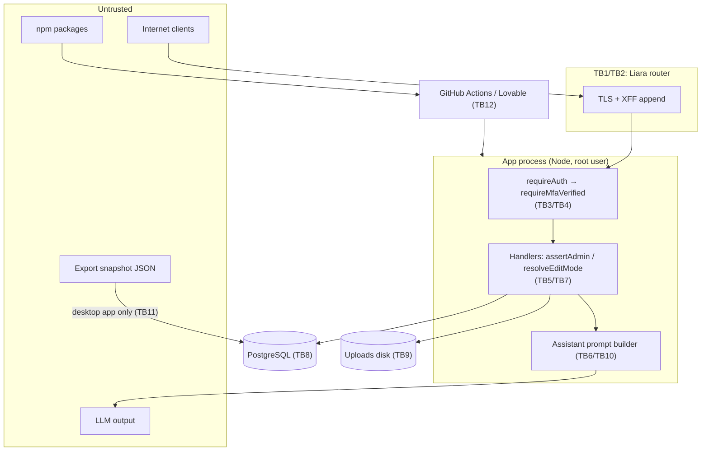

# Trust Boundaries

| # | Boundary | Crossing data | Enforcement | Weaknesses found |
|---|---|---|---|---|
| TB1 | Internet → Liara router | All HTTP traffic | TLS at Liara; HSTS now sent (SEC-016) | Client-supplied `X-Forwarded-For` was trusted (SEC-003, fixed) |
| TB2 | Router → app process | Requests + forwarded headers | Only the proxy-appended XFF entry is trusted (`TRUSTED_PROXY_HOPS`) | — |
| TB3 | Anonymous → authenticated | Session cookie | Opaque token looked up in `sessions` | Tokens stored unhashed (SEC-027) |
| TB4 | Password-authenticated → MFA-verified | OTP | `requireMfaVerified` (only when `MFA_ENFORCED=true`) | Verification shared across sessions and phone replaceable without MFA (SEC-004/005, fixed); MFA off by default (SEC-026) |
| TB5 | User → company owner | `owner_user_id` | `resolveEditMode()` ownership check per call | None found (authz suite 51/51) |
| TB6 | Owner → public | Approved content | Admin approval + change requests | Owner text flows into the LLM prompt (SEC-021) |
| TB7 | Owner/admin → admin | Roles | In-handler `assertAdmin` | First-user-admin trigger (SEC-029) |
| TB8 | App → database | SQL | postgres.js parameterization; no RLS | Identifier interpolation in offline import (SEC-020, fixed); TLS without cert verification (SEC-030) |
| TB9 | App → uploads disk | Files | Extension allowlist, size limits, path confinement | Container runs as root (SEC-011) |
| TB10 | App → LLM / SMS providers | Prompts, OTPs | HTTPS, server-side keys | No timeouts (SEC-019, fixed) |
| TB11 | Live site → desktop app | Export JSON | HTTPS fetch | Snapshot keys used as SQL identifiers (SEC-020, fixed) |
| TB12 | GitHub/Lovable → production | Code, secrets | Deploy on `main` only | Token scope, action pinning, CLI pinning (SEC-009, fixed); stale npm lockfile (SEC-010) |
| TB13 | Developers → repository | Secrets | `.gitignore` | `.env` in history (SEC-022); hashed initial passwords committed (SEC-023) |

